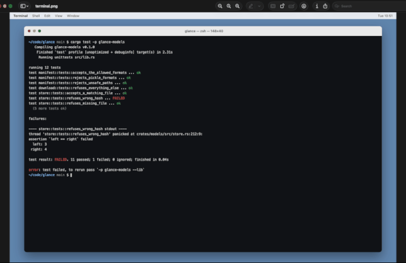

<!-- TODO: logo. Add docs/images/logo.png (see docs/images/README.md), then:
<p align="center"></p> -->

<div align="center">

# glance

**Ask your Mac about what's on screen, out loud, and hear the answer, with everything running locally.**



</div>

Hold a hotkey, ask ("what's this error?", "how much did we spend in
August?"), let go. glance takes a screenshot, transcribes your question,
asks a local vision model, and speaks the answer while it streams onto a
small overlay.

> **Status: early.** macOS on Apple Silicon only, built from source. See
> [Status and limitations](#status-and-limitations).

## Why glance

- **Your screen never leaves your Mac.** Speech recognition, the vision
  model and the voice all run locally. No account, no cloud, no telemetry.
- **Fast enough to talk to.** About 1.1 s from letting go of the key to the
  first spoken word (4B model, measured on an M4 Pro).
- **Hands-free questions.** No copying text or attaching screenshots: you
  ask about whatever is in front of you.
- **Small, inspectable and pinned.** One Rust workspace; every model file is
  pinned by commit and SHA-256; no GPL-family dependencies.

## Requirements

- Apple Silicon Mac, macOS 14.2 or later.
- Xcode Command Line Tools (full Xcode is not needed) and
  [rustup](https://rustup.rs); the Rust version is pinned in
  `rust-toolchain.toml`.
- `llama-server` from llama.cpp: `brew install llama.cpp`. glance looks for it
  only in `/opt/homebrew/bin` and `/usr/local/bin` (never `PATH`), or at
  `[models] llama_server` in the config file.
- Disk: about 4.3 GB for the default models (setup keeps 2 GB free beyond
  that); another 18.4 GB for the optional *think harder* model.

**Memory.** Measured resident memory (glance with speech recognition and the
voice, plus its model server):

| Setup | FAST model | Think harder (DEEP) | Memory |
|---|---|---|---|
| Default | Qwen3-VL 4B | off | 7.0 GB |
| Larger FAST | Qwen3-VL 8B | off | 9.8 GB |
| With DEEP loaded | Qwen3-VL 4B | Qwen3.8 27B, on demand | 26.4 GB (7.0 GB while DEEP is unloaded) |

What setup offers by RAM (it recommends Basics everywhere; the others are
under "Advanced"):

| RAM | Offered |
|---|---|
| Under 16 GB | Not supported: only Basics, with a warning (glance needs about 7 GB beside macOS) |
| 16 GB | Basics. Untested on a 16 GB Mac |
| 32 GB | Basics, or Sharper reading (8B). Untested on a 32 GB Mac |
| 48 GB+ | Basics, Sharper reading, or Basics + think harder (DEEP on demand). Measured on 48 GB |

## Quick start

**1. Build and open the app**

```sh
git clone https://github.com/Matty-PW/glance && cd glance
brew install llama.cpp                          # provides llama-server
cargo xtask bundle                              # → target/bundle/Glance.app
open target/bundle/Glance.app
```

**2. Follow setup.** On first launch glance opens a setup window, one step
at a time:
- **Your Mac:** chip, memory and free disk, and a recommended setup (what it
  includes, the download size and the memory it uses). Others are under
  "Advanced".
- **Permissions:** Screen Recording and Microphone, each with a button to
  allow it or open the right System Settings pane. If macOS needs glance to
  restart after Screen Recording, the page says so and restarts it.
- **Download models:** about 4.3 GB for Basics, from Hugging Face only, each
  file checked against its pinned SHA-256. You can pause, close the window,
  or quit; it carries on where it stopped.
- **Try it:** a test question on a built-in picture of a chart (not your
  screen): you read a question aloud and hear the answer, with the time to
  the first word, or which part failed and what to do.

No config file editing is needed. Setup opens again later from the menu-bar
menu ("Set up glance…") or Settings → About ("Run setup again").
`glance app --setup-demo` walks through it on made-up data.

### Keep permissions across rebuilds

macOS ties permission grants to the app's signing identity. Without one,
`cargo xtask bundle` signs ad hoc and macOS asks again after each build.
With your own code-signing certificate, grants survive rebuilds:

```sh
security find-identity -v -p codesigning        # pick a signing identity
export GLANCE_SIGN_IDENTITY=<its SHA-1>
cargo xtask bundle
```

**3. From the command line** (optional): the same pinned downloads are
`glance models pull <id>` (see `glance models list`), with
`alias glance='cargo run --release -q -p glance --'`.

**4. Ask.**

| Hotkey | Action |
|---|---|
| Hold `⌃ ⌥ G` | Ask about the screen. Follow-ups reuse the same screenshot. |
| Hold `⌃ ⌥ ⇧ G` | Take a fresh screenshot, then ask. |
| Tap `⌃ ⌥ T` | *Think harder:* ask the bigger model the last question again. |
| Hold `⌃ ⌥ T` | Ask the bigger model something new about the same screenshot. |

Speak while holding, let go to get the answer. Any hotkey stops a reply and
starts listening. "Tell me more" continues an answer; saying "think harder"
works like the hotkey. Hotkeys can be changed in Settings.

## Configuration

Open **Settings…** from the menu-bar icon (sections: Voice, Answers,
Personality, Think harder, Models, Hotkeys, Appearance, About), or edit
`~/Library/Application Support/glance/config.toml`. The main settings:

| Setting | Default | What it does |
|---|---|---|
| `speech.engine` | `kokoro` | Kokoro (local neural voice) or `system` (the macOS voice) |
| `speech.voice` | `af_heart` | Kokoro voice, or a blend such as `af_heart:0.6,bf_emma:0.4` |
| `speech.speed` | `1.0` | Kokoro pace, 0.5 to 2.0 |
| `speech.math_as_words` | `false` | Say "2 × 2 = 4" as "2 times 2 equals 4" |
| `models.fast` | `qwen3-vl-4b-instruct-q4km` | The model that answers every question |
| `models.deep` | none | Optional bigger model for *think harder*, loaded on demand |
| `models.response_length` | `medium` | `short`, `medium` or `long` |
| `models.personality` | `neutral` | Also `friendly`, `direct`, `strict`, `pirate`, `caveman`, `shakespearean`, `custom` |
| `models.auto_escalate` | `false` | Let FAST hand hard questions to DEEP by itself |
| `models.llama_server` | none | Absolute path to `llama-server`; otherwise `/opt/homebrew/bin`, then `/usr/local/bin` |
| `appearance.accent` | `glance` | Accent colour: glance's coral or the macOS accent (`system`) |
| `appearance.screenshot_indicator` | `glow` | On a new screenshot: a short `glow` around the edge of the captured display, `subtle` (a thin line) or `off`. The overlay also says "New screenshot taken" or "Using screenshot from 12 s ago". Never in the image sent to the model |
| `hotkeys.talk` / `look` / `think` | `Ctrl+Opt+G` / `Ctrl+Opt+Shift+G` / `Ctrl+Opt+T` | The three chords |

An invalid file is reported with the problem named; glance never silently
ignores a setting. Every option is documented at the top of
[`crates/app/src/config.rs`](crates/app/src/config.rs).

## Architecture

```
            menu-bar app (glance-macos: AppKit, ScreenCaptureKit, Carbon hotkeys)
 hotkey ─────────┐
                 ▼
          ┌─────────────┐  screenshot  ┌──────────────────────────┐
          │ orchestrator│─────────────►│ FAST llama-server        │
 mic ────►│ (turns,     │  question    │ 127.0.0.1, random port,  │
 (memory  │  sessions,  │─────────────►│ per-launch key           │
  only)   │  think      │◄─ sentences ─│ (DEEP: same, on demand)  │
          │  harder)    │              └──────────────────────────┘
          └──────┬──────┘
   Parakeet STT  │  sentences
   (in-process)  ▼
          voice (Kokoro / macOS) ──► speakers
          overlay text ─────────────► floating panel
```

The orchestrator owns the turn: it sends the screenshot to the model while
you talk, transcribes when you let go, streams the answer sentence by
sentence to the voice and the overlay, and keeps a session for follow-ups.
Capture, hotkeys, audio, speech recognition, voices and the model client sit
behind traits, so the core crates contain no platform code and are tested
with mocks. The design is in [docs/DESIGN.md](docs/DESIGN.md).

## Privacy and security

What glance does, and where the code enforces it:

- **Screenshots and audio stay in memory.** They are never written to disk.
  Each screenshot is a PNG held in memory and sent only to glance's own
  model server; recordings are buffers that are dropped after
  transcription.
- **glance's own windows are left out** of the screenshots it takes.
- **Model servers are local and private.** glance starts `llama-server`
  bound to `127.0.0.1` on a random port, with a key created for each launch
  (passed in the environment, so it never appears in `ps`). Endpoints you
  configure yourself must also be loopback.
- **The model can't act.** Screen content is treated as untrusted input:
  the model has no tools, no shell and no file access. Its output is only
  shown and spoken.
- **No telemetry**, analytics, crash reporting or update checks.

**Network access, completely:**

| When | What | Why |
|---|---|---|
| **Running glance** | **Model downloads from Hugging Face** (`huggingface.co`, redirects only to an exact list of Hugging Face CDN hosts, HTTPS only, each file checked against its pinned SHA-256) | Only when you download a model (setup, Settings → Models, or `glance models pull`) |
| Running glance | `127.0.0.1` only | Talking to its own model servers |
| Building glance | crates.io (Cargo), and ONNX Runtime from `cdn.pyke.io` (the `ort-sys` build script, checked against a SHA-256 in the crate) | Compiling only; nothing is downloaded at run time |

Downloading a model is the only time glance itself uses the network. More
detail, and how to report a vulnerability: [SECURITY.md](SECURITY.md).

## Models and licences

glance **does not include or redistribute any model weights.** The
repository holds only [`models.toml`](models.toml), which pins each file by
Hugging Face commit, size and SHA-256. You download the weights yourself,
from that manifest only, and each model stays under its own licence:

| Model | Role | Size | Licence |
|---|---|---|---|
| Qwen3-VL 4B Instruct (Q4_K_M) | FAST, default | 3.3 GB | Apache-2.0 |
| Qwen3-VL 8B Instruct (Q4_K_M) | FAST, larger | 6.2 GB | Apache-2.0 |
| LFM2.5-VL 3B (Q4_K_M) | FAST, alternative | 2.5 GB | LFM Open License v1.0 |
| Qwen3.8 27B (Q4_K_M) | DEEP, think harder | 18.4 GB | Apache-2.0 |
| Parakeet TDT 0.6B v3 (int8) | Speech recognition | 0.7 GB | CC-BY-4.0 (NVIDIA) |
| Kokoro-82M v1.0 + 28 English voices | Voice | 0.3 GB | Apache-2.0 |

**LFM Open License, in plain words:** free to use, change and share. If you
share it, include the licence and mark your changes. Commercial use is
licensed only while you and your affiliated companies have under USD 10
million in annual revenue. Suing over patents in the model, or breaking the
terms, ends the licence. The LFM model is optional and never downloaded
unless you ask.

Full attributions (including NVIDIA's Parakeet under CC-BY-4.0) and the
third-party caveats are in [THIRD_PARTY.md](THIRD_PARTY.md).

## Status and limitations

glance is early software, built and tested by one developer on one Mac.

- **macOS only, Apple Silicon only.** Windows is planned (the platform code
  already sits behind traits); there is no Windows code yet.
- **Source only: no binaries are distributed.** You build glance yourself.
  Before any binary is released, one licensing question must be resolved:
  the pronunciation dictionaries compiled into glance (from the misaki-rs
  phonemizer) have no licence statement of their own and were partly
  produced with GPL-licensed eSpeak NG. The likely fix is switching to the
  CMUdict dictionary; details in [THIRD_PARTY.md](THIRD_PARTY.md).
- **Not yet accepted end to end.** All planned features (milestones M0 to M5,
  see [docs/PROGRESS.md](docs/PROGRESS.md)) are built and tested with mocks,
  benchmarks and in-process UI snapshots. The hands-on runs through the app
  (permission prompts, spoken turns, the redesigned windows) are still open.
- **English.** The voices and prompts are English. TODO: other languages
  are untested.
- **No remote models yet.** Only local servers; remote endpoints with keys
  in the macOS Keychain are a later milestone.

## Contributing

Contributions are welcome. [CONTRIBUTING.md](CONTRIBUTING.md) covers building,
testing, the checks every change must pass, and the project's privacy and
dependency rules. Please report security issues privately, as described in
[SECURITY.md](SECURITY.md).

## Licence

glance is licensed under either of

- [Apache License, Version 2.0](LICENSE-APACHE)
- [MIT licence](LICENSE-MIT)

at your option. Unless you state otherwise, any contribution you submit for
inclusion in glance is dual-licensed as above, without any additional terms
or conditions.

Dependency and model licences, and third-party notes: [THIRD_PARTY.md](THIRD_PARTY.md).
No binaries are distributed; see the dictionary-data note under
[Status and limitations](#status-and-limitations) before publishing any.
